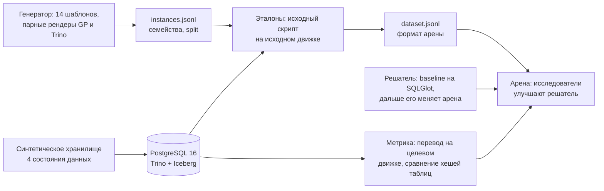

# SQLTR: перевод SQL-скриптов между диалектами, навык, выращенный на арене

Задание B курса Agentic LLM Systems (ИТМО × DeepPavlov, осень 2026). Тема: своя, согласована.

Решатель переводит многошаговый SQL-скрипт между диалектами PostgreSQL/Greenplum и Trino на Iceberg, в обе стороны. Перевод засчитывается, если на целевом движке он дает те же выходные таблицы, что исходный скрипт на исходном движке, на каждом из четырех состояний данных. Метрика программная, без LLM. Решение выращивается эволюцией на арене DeepPavlov поверх baseline на SQLGlot.

## Итог в одной таблице

| | Train | Public | Private |
|---|---|---|---|
| Baseline (SQLGlot), trino2gp | 0.116 | до старта кампании | после кампании |
| Baseline (SQLGlot), gp2trino | 0.012 | до старта кампании | после кампании |
| Выращенное решение | - | - | - |

Лимит предложенных решений: ориентир 50, замер на стенде его подтверждает (полный train - 9-17 минут на кандидата, [замер](results/stand/full-train-2026-11-08.json)). Кандидатов в журнале: 0. AUC: -.

Train-цифры получены на VM 8.11 (2 vCPU, 8 ГБ RAM) исполнением на настоящих PostgreSQL и Trino: [сводка](results/baseline/train/summary.json), [материалы стенда](results/stand/). Self-check: все 250 пар train и все 12 пар holdout дают равные результаты на двух движках. На holdout baseline решает gp2trino 1 из 12, trino2gp 0 из 12 ([сводка](results/baseline/holdout/summary.json)).

## Как устроено



## Структура

```
case/                  кейс арены
  metric/              пакет метрики: metric.json, score.py, sqltr_metric/, тесты
  dataset/             описание данных и split, generate.py
  campaign/            условия кампании (черновик до подготовки кампании)
  ways/baseline/       стартовый кандидат: SQLGlot, контракт runner арены
  harness/             харнес sqltr-program: адаптер runner, образ sqltr-runner:1 (ADR 0008)
  acceptance/          синтетическая приёмка развёртывания арены (19 проверок), замер стоимости кандидата
  deploy/              развёртывание оценщиков на одной VM: operator.env, arena.sh
  researcher/          образ исследователя с Hermes, шлюз модели с лимитом расходов, репетиция без расходов (ADR 0007)
sqltr/                 генератор, хранилище, эталоны, локальный раннер (python -m sqltr)
stand/                 docker compose: PostgreSQL 16 + Trino 483/Iceberg, скрипты для VM
docs/                  domain.md, arena.md, adr/, evolution.md, solution.md, talk.md
skill/                 итоговый навык (после кампании)
results/               сводки замеров; сырые логи в results/**/raw (вне git)
operator/              сиды и данные public/private (вне git, только у оператора)
```

## Как воспроизвести

Локально (нужен только PostgreSQL; Trino-часть пропускается):

```bash
pip install -e . pytest
export SQLTR_PG_HOST=127.0.0.1                      # sqltr_admin - владелец базы sqltr
python -m sqltr --local setup-pg
python -m sqltr --local load-states --engine postgres
python -m pytest -q                                   # 73 теста: метрика (включая жульнические решения), генератор, харнес, holdout, шлюз модели
python -m sqltr build-dataset --split train --families 250 --seed 20261101 --out data/train
python -m sqltr --local build-references --split-dir data/train
python -m sqltr --local run-local --split-dir data/train --directions trino2gp --no-cache --out results/baseline/train-trino2gp
```

На VM (полный стенд, оба направления):

```bash
bash stand/vm-setup.sh          # один раз: Docker, uv
cp stand/.env.example stand/.env && nano stand/.env
bash stand/bootstrap.sh         # стенд, данные, эталоны на Trino, self-check, baseline, тесты
```

Public и private генерирует оператор с секретными сидами из `operator/seeds.json` (каталог вне git):

```bash
mkdir -p operator && python -c "import json, secrets; print(json.dumps({'public': secrets.randbits(62), 'private': secrets.randbits(62), 'secret': secrets.token_hex(16)}))" > operator/seeds.json
python -m sqltr build-dataset --split public  --families 100 --seed-file operator/seeds.json --exclude data/train/instances.jsonl --out operator/public
python -m sqltr build-dataset --split private --families 100 --seed-file operator/seeds.json --exclude data/train/instances.jsonl operator/public/instances.jsonl --out operator/private
```

Приёмка арены на синтетике (поднимает train/public/private, проходит мини-кампанию до private):

```bash
python case/acceptance/run.py --arena /opt/arena --work /tmp/sqltr-accept --runner-image sqltr-runner:1 --local
```

Локальный прогон 4.11 только на PostgreSQL: 19/19 проверок ([отчёт](results/acceptance/local-2026-11-04.json)). На VM 8.11 с Trino и обоими направлениями: 19/19 за 302 с ([отчёт](results/acceptance/vm-2026-11-08.json)). Развёртывание на VM - [case/deploy/README.md](case/deploy/README.md).

## Модели

Исследователи арены и LLM-фоллбэк решателя: Claude Haiku 5.5, уровень усилия Max. Индекс Artificial Analysis - 36, у DeepSeek V4.1 Flash 1017 - 32 (проверено 31.10.2026), поэтому правило курса 0-1 выполнено. Основная кампания идет с решателем без модели; LLM-харнес подключается после приемки gateway. Все вызовы модели исследователя идут через свой шлюз с лимитом расходов: ключ есть только у него. Вся цепочка проверена без расходов, с фальшивым провайдером ([отчет](results/researcher/rehearsal-2026-11-08.json)); настоящих вызовов модели пока не было. Подробности в [ADR 0007](docs/adr/0007-models.md) и [case/researcher/README.md](case/researcher/README.md).

## Арена

Арена закреплена по SHA-256 архива `18519eee87328febd8f3f7ea772705bdf2400fbd4610ff9cb05adcc3a8c8a687`, код арены в репозиторий не копируется ([ADR 0001](docs/adr/0001-arena-pin.md)). Как мы понимаем арену и как кейс ложится на ее контракт - в [docs/arena.md](docs/arena.md).
